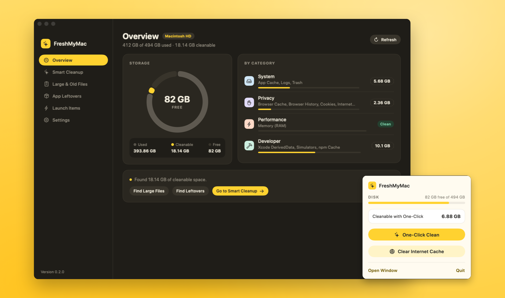
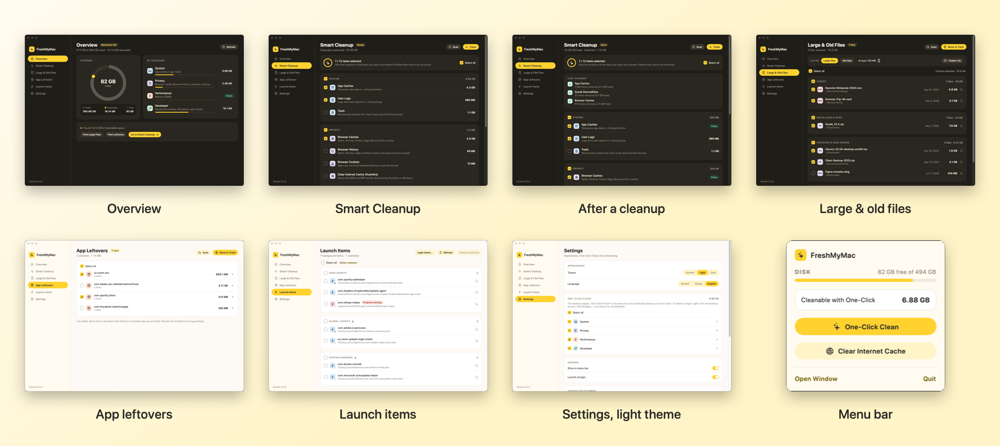

<p align="center">
  
</p>

<h1 align="center">FreshMyMac</h1>

<p align="center">
  A small, native macOS cleaner: pick what to clean, see how much space you'll get back, clean with one click.<br>
  <a href="README.tr.md">Türkçe</a>
</p>

<p align="center">
  
</p>

## Download

**[Download the latest release](https://github.com/osbendes/freshmymac/releases/latest)**: `FreshMyMac-x.y.z.zip`, for Apple Silicon and Intel, macOS 14 or later.

1. Unzip it and drag **FreshMyMac.app** to your Applications folder.
2. Open it. Because the app isn't notarized by Apple, macOS blocks the first launch: close the warning, go to **System Settings › Privacy & Security** and click **Open Anyway** at the bottom. This is needed only once.
3. On first launch FreshMyMac offers the one-time administrator permission and Full Disk Access (see [Permissions](#permissions)).

## Features

- **Smart Cleanup**: app caches, user logs, Trash, browser caches/history/cookies, Quick Look thumbnails, Xcode DerivedData, unavailable simulators, Homebrew and npm caches. Every task shows its size before you clean.
- **Clear Internet Cache**: the macOS equivalent of Windows' `ipconfig /flushdns` (DNS + ARP cache).
- **Free Up Memory**: releases inactive RAM (`purge`).
- **Large & Old Files**: finds big or long-unused files in Downloads, Desktop, Documents, Movies and Music, grouped by type. Files are moved to the Trash, not deleted.
- **App Leftovers**: finds preferences, caches and support files left behind by uninstalled apps.
- **Launch Items**: lists LaunchAgents/LaunchDaemons and flags orphaned ones whose program no longer exists.
- **One-Click Clean**: a preset you choose once, run from the desktop widget, the menu bar or on a daily/weekly schedule.
- **Desktop widget** in three sizes; the large one lets you pick tasks right on the desktop.
- **Light and dark themes**, **Turkish and English**. "System" uses Turkish when the system language is Turkish, English otherwise.

<p align="center">
  
</p>

## Requirements

- macOS 14 Sonoma or later
- Xcode command line tools (Swift 6) to build

## Build and run

To build from source instead, quick run during development (no widget, notifications or launch-at-login):

```bash
swift run
```

Build the full app bundle with the widget and install it to `~/Applications`:

```bash
./scripts/build-app.sh --install
```

The widget only appears in the widget gallery when the app is signed with an **Apple Development** certificate. A free Apple ID is enough: sign in under Xcode › Settings › Accounts and create the certificate under *Manage Certificates*. The build script picks it up automatically. To sign with your own identifiers:

```bash
BUNDLE_ID=com.example.FreshMyMac SIGN_IDENTITY="Apple Development: you@example.com (TEAMID)" ./scripts/build-app.sh --install
```

Then right-click the desktop › **Edit Widgets…** and search for FreshMyMac.

`./scripts/build-app.sh --release` builds the downloadable zip: a universal (Apple Silicon + Intel) app, ad-hoc signed so the release doesn't carry the developer's certificate details.

## Permissions

- **Full Disk Access** is needed for the Trash, Safari history and some app containers. Rows that can't be read show *No access*, and clicking it opens the right settings pane.
- **Administrator permission (one time)**: Clear Internet Cache and Free Up Memory run as root. On first launch FreshMyMac offers to grant this once: after a single password prompt it installs `/etc/sudoers.d/freshmymac`, which lets only these exact commands run without a password:
  `dscacheutil -flushcache`, `killall -HUP mDNSResponder`, `arp -a -d`, `purge`. The rule is checked with `visudo` before it is installed and can be removed under Settings › Permissions. Without it, the password is asked once per cleanup.

## Safety

- Cache, log and Trash tasks delete permanently. Large files, leftovers and launch items are moved to the Trash and can be restored.
- Browser history and cookie tasks are skipped while the browser is running.
- The leftover scan is conservative: if any app from the same developer (e.g. `com.google`) is installed or running, none of that developer's files are listed.
- Scheduled cleanups skip tasks that would need a password (when the one-time permission isn't granted) or need a browser to be closed.

## Project layout

```
Sources/FreshMyMac/
├── FreshMyMacApp.swift      App entry: window, menu bar, URL and Dock handling
├── Core/                    Cleanup logic, independent of the UI
│   ├── TaskCatalog.swift    All Smart Cleanup tasks; add new ones here
│   ├── CleanupEngine.swift  Scanning and deleting
│   └── …                    Large files, leftovers, launch items, shell, system info
├── Shared/                  Compiled into both the app and the widget
│   ├── Localization.swift   L("Türkçe", "English") helper
│   └── WidgetStatus.swift   Files shared with the widget
├── ViewModel/               App state, settings, scheduler
└── Views/                   SwiftUI screens and the design system (Theme.swift)
Widget/                      WidgetKit extension
scripts/
├── build-app.sh             Builds, signs and installs the .app with the widget
└── make-icon.swift          Generates Resources/AppIcon.icns
```

The widget is built with `swiftc` instead of an Xcode project. `build-app.sh` reproduces what Xcode does for app extensions: the `_NSExtensionMain` entry point, the platform keys in Info.plist, and the App Intents metadata.

### Adding a cleanup task

Add a `CleanupTask` to `Core/TaskCatalog.swift`, with the title and subtitle in both languages:

```swift
CleanupTask(
    id: "example",
    title: LText("Örnek Önbellek", "Example Cache"),
    subtitle: LText("~/Library/Caches/Example", "~/Library/Caches/Example"),
    icon: "archivebox",
    category: .system,
    action: .deleteContents(of: [lib("Caches/Example")])
)
```

Available actions: `.deleteContents(of:)`, `.deleteItems { [URL] }`, `.shell("…")`, `.adminShell("…")`.

### Screenshots

The app can open any screen in a given theme and language and save the window as a PNG:

```bash
swift build
.build/debug/FreshMyMac -screen cleanup -appearanceMode dark -appLanguage en -snapshot ~/Desktop/cleanup.png
```

`-screen`: `overview`, `cleanup`, `largeFiles`, `leftovers`, `launchItems`, `settings` · `-appearanceMode`: `system`, `light`, `dark` · `-appLanguage`: `system`, `tr`, `en`

The README images use sample content (no real files or user names) and are made with:

```bash
./scripts/build-app.sh
./scripts/screenshots.sh build/shots            # every screen, both languages and themes (-demo YES)
swift scripts/make_promo.swift build/shots docs/images build/stories
```

## License

MIT. See [LICENSE](LICENSE).
