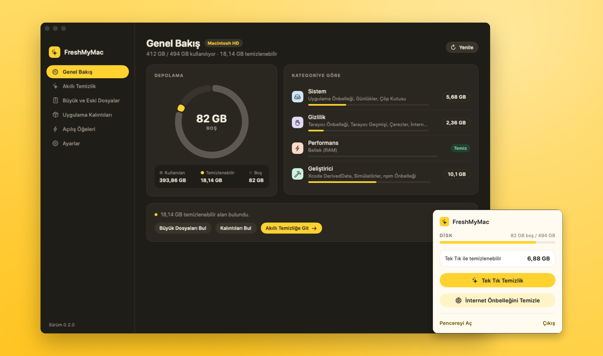
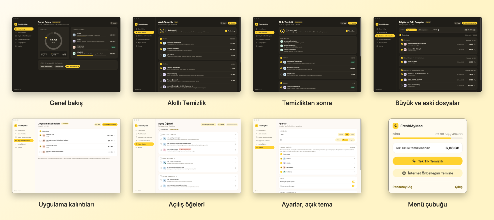

<p align="center">
  
</p>

<h1 align="center">FreshMyMac</h1>

<p align="center">
  Küçük, yerel bir macOS temizleyicisi: neyi temizleyeceğinizi seçin, ne kadar yer kazanacağınızı görün, tek tıkla temizleyin.<br>
  <a href="README.md">English</a>
</p>

<p align="center">
  
</p>

## İndir

**[Son sürümü indirin](https://github.com/osbendes/freshmymac/releases/latest)**: `FreshMyMac-x.y.z.zip`. Apple Silicon ve Intel Mac'ler için, macOS 14 veya üstü.

1. Zip'i açın ve **FreshMyMac.app** dosyasını Uygulamalar klasörüne sürükleyin.
2. Uygulamayı açın. Uygulama Apple tarafından noter onaylı olmadığı için macOS ilk açılışı engeller: uyarıyı kapatın, **Sistem Ayarları › Gizlilik ve Güvenlik** bölümüne gidin ve en alttaki **Yine de Aç** düğmesine basın. Bu yalnızca bir kez gerekir.
3. İlk açılışta FreshMyMac tek seferlik yönetici iznini ve Tam Disk Erişimi'ni önerir (ayrıntılar aşağıdaki İzinler bölümünde).

## Özellikler

- **Akıllı Temizlik**: uygulama önbellekleri, kullanıcı günlükleri, Çöp Kutusu, tarayıcı önbelleği/geçmişi/çerezleri, Quick Look küçük resimleri, Xcode DerivedData, kullanılamayan simülatörler, Homebrew ve npm önbellekleri. Her görev temizlemeden önce boyutunu gösterir.
- **İnternet Önbelleğini Temizle**: Windows'taki `ipconfig /flushdns` komutunun macOS karşılığı (DNS + ARP önbelleği).
- **Belleği Boşalt**: etkin olmayan RAM'i serbest bırakır (`purge`).
- **Büyük ve Eski Dosyalar**: İndirilenler, Masaüstü, Belgeler, Filmler ve Müzik'teki büyük ya da uzun süredir açılmayan dosyaları türe göre gruplar. Dosyalar silinmez, Çöp Kutusu'na taşınır.
- **Uygulama Kalıntıları**: kaldırılmış uygulamaların geride bıraktığı tercih, önbellek ve destek dosyalarını bulur.
- **Açılış Öğeleri**: LaunchAgent/LaunchDaemon listesini gösterir, programı artık bulunmayan sahipsiz öğeleri işaretler.
- **Tek Tık Temizlik**: bir kez seçtiğiniz ön ayar. Masaüstü widget'ından, menü çubuğundan ya da günlük/haftalık zamanlamayla çalışır.
- **Masaüstü widget'ı**: üç boyut. Büyük boyda görevleri doğrudan masaüstünden seçebilirsiniz.
- **Açık ve koyu tema**, **Türkçe ve İngilizce**. "Sistem" seçiliyse sistem dili Türkçe olduğunda Türkçe, diğer dillerde İngilizce açılır.

<p align="center">
  
</p>

## Gereksinimler

- macOS 14 Sonoma veya üstü
- Derlemek için Xcode komut satırı araçları (Swift 6)

## Derleme ve çalıştırma

Kaynaktan derlemek isterseniz, geliştirme sırasında hızlı çalıştırma (widget, bildirim ve oturum açılışı olmadan):

```bash
swift run
```

Widget'lı tam uygulama paketini derleyip `~/Applications` klasörüne kurmak için:

```bash
./scripts/build-app.sh --install
```

Widget'ın galeride görünmesi için uygulamanın **Apple Development** sertifikasıyla imzalanması gerekir. Ücretsiz bir Apple ID yeterli: Xcode › Settings › Accounts'ta oturum açıp *Manage Certificates* bölümünden sertifikayı oluşturun. Betik sertifikayı kendiliğinden bulur. Kendi kimliklerinizle imzalamak için:

```bash
BUNDLE_ID=com.ornek.FreshMyMac SIGN_IDENTITY="Apple Development: siz@ornek.com (TEAMID)" ./scripts/build-app.sh --install
```

Ardından masaüstüne sağ tıklayın › **Widget'ları Düzenle…** › "FreshMyMac" arayın.

`./scripts/build-app.sh --release` indirilebilir zip dosyasını üretir: universal (Apple Silicon + Intel) uygulama, sürümde geliştiricinin sertifika bilgileri bulunmasın diye ad-hoc imzalı.

## İzinler

- **Tam Disk Erişimi**: Çöp Kutusu, Safari geçmişi ve bazı uygulama kapsayıcıları için gerekir. Okunamayan satırlarda *Erişim yok* yazar, tıklayınca ilgili ayar açılır.
- **Yönetici izni (tek seferlik)**: İnternet Önbelleğini Temizle ve Belleği Boşalt root yetkisiyle çalışır. İlk açılışta FreshMyMac bu izni bir kez vermeyi önerir: tek bir şifre isteminden sonra `/etc/sudoers.d/freshmymac` kurulur ve yalnızca şu komutlar, bu argümanlarla, şifresiz çalışabilir:
  `dscacheutil -flushcache`, `killall -HUP mDNSResponder`, `arp -a -d`, `purge`. Kural kurulmadan önce `visudo` ile doğrulanır ve Ayarlar › İzinler'den kaldırılabilir. İzin verilmezse şifre her temizlikte bir kez sorulur.

## Güvenlik

- Önbellek, günlük ve Çöp Kutusu görevleri kalıcı olarak siler. Büyük dosyalar, kalıntılar ve açılış öğeleri Çöp Kutusu'na taşınır, geri alınabilir.
- Tarayıcı geçmişi ve çerez görevleri tarayıcı açıkken atlanır.
- Kalıntı taraması temkinlidir: aynı geliştiricinin (ör. `com.google`) kurulu ya da çalışan bir uygulaması varsa o geliştiriciye ait hiçbir dosya listelenmez.
- Zamanlanmış temizlik, şifre gerektirecek (tek seferlik izin verilmemişse) ya da tarayıcının kapalı olmasını gerektiren görevleri atlar.

## Proje yapısı

```
Sources/FreshMyMac/
├── FreshMyMacApp.swift      Uygulama girişi: pencere, menü çubuğu, URL ve Dock işleme
├── Core/                    Temizlik mantığı (arayüzden bağımsız)
│   ├── TaskCatalog.swift    Akıllı Temizlik görevleri; yenileri buraya eklenir
│   ├── CleanupEngine.swift  Tarama ve silme
│   └── …                    Büyük dosyalar, kalıntılar, açılış öğeleri, kabuk, sistem bilgisi
├── Shared/                  Hem uygulamada hem widget'ta derlenir
│   ├── Localization.swift   L("Türkçe", "English") yardımcısı
│   └── WidgetStatus.swift   Widget ile paylaşılan dosyalar
├── ViewModel/               Uygulama durumu, ayarlar, zamanlayıcı
└── Views/                   SwiftUI ekranları ve tasarım sistemi (Theme.swift)
Widget/                      WidgetKit uzantısı
scripts/
├── build-app.sh             .app'i widget'la birlikte derler, imzalar ve kurar
└── make-icon.swift          Resources/AppIcon.icns dosyasını üretir
```

Widget, Xcode projesi yerine `swiftc` ile derlenir. `build-app.sh`, Xcode'un uzantılar için yaptıklarını yeniden üretir: `_NSExtensionMain` giriş noktası, Info.plist'teki platform anahtarları ve App Intents metadata'sı.

### Yeni temizlik görevi eklemek

`Core/TaskCatalog.swift` içine başlığı ve açıklaması iki dilde olan bir `CleanupTask` ekleyin:

```swift
CleanupTask(
    id: "example",
    title: LText("Örnek Önbellek", "Example Cache"),
    subtitle: LText("~/Library/Caches/Example", "~/Library/Caches/Example"),
    icon: "archivebox",
    category: .system,
    action: .deleteContents(of: [lib("Caches/Example")])
)
```

Kullanılabilir eylemler: `.deleteContents(of:)`, `.deleteItems { [URL] }`, `.shell("…")`, `.adminShell("…")`.

### Ekran görüntüleri

Uygulama istenen ekranı istenen tema ve dilde açıp penceresini PNG olarak kaydedebilir:

```bash
swift build
.build/debug/FreshMyMac -screen cleanup -appearanceMode dark -appLanguage tr -snapshot ~/Desktop/cleanup.png
```

`-screen`: `overview`, `cleanup`, `largeFiles`, `leftovers`, `launchItems`, `settings` · `-appearanceMode`: `system`, `light`, `dark` · `-appLanguage`: `system`, `tr`, `en`

README görselleri örnek içerik kullanır (gerçek dosya ya da kullanıcı adı yok) ve şöyle üretilir:

```bash
./scripts/build-app.sh
./scripts/screenshots.sh build/shots            # her ekran, iki dil ve iki tema (-demo YES)
swift scripts/make_promo.swift build/shots docs/images build/stories
```

## Lisans

MIT. Ayrıntılar için [LICENSE](LICENSE).
